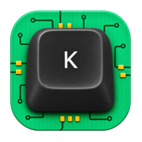

# Klick

Klick adds mechanical keyboard sounds to your Mac. Choose a switch, adjust its tone and volume, and decide when and where to hear it from the menu bar.

[**Download Klick for Mac**](https://github.com/AdiArya05/klick/releases/latest/download/Klick-macOS.zip) · [Release notes](https://github.com/AdiArya05/klick/releases/latest)

Requires macOS 14 or later on Apple silicon or Intel. The ZIP contains the finished app.

## First setup

1. Unzip **Klick-macOS.zip**, drag **Klick.app** to **Applications**, and open it from there. If updating, quit the old copy first and replace it. Quit any older copy named Keyfeel as well.
2. If macOS shows **“Klick” Not Opened**, click **Done**. Open **System Settings → Privacy & Security**, scroll down, and choose **Open Anyway** for Klick, then confirm **Open**. The current release is ad-hoc signed and requires this one-time approval on a fresh download. [Apple’s first-launch instructions](https://support.apple.com/en-us/102445)
3. Click the keyboard icon in the menu bar. Disconnect any external keyboard for the first test, set **Output** to **System Default** or your Mac’s speakers, raise **Volume**, and press **▶**. The preview works before granting Input Monitoring.
4. Click **Enable Input Monitoring** in Klick. Turn on **Klick** in **System Settings → Privacy & Security → Input Monitoring**. Choose **Quit & Reopen** if macOS offers it. Open the menu and confirm **Typing sounds on**, then try a few keys in TextEdit. [Apple’s Input Monitoring instructions](https://support.apple.com/guide/mac-help/mchl4cedafb6/mac)

## Choose when and where to hear it

- In the **…** menu, choose **Only when no external keyboard is connected** (the default) or **With any keyboard**. The main toggle pauses typing sounds whenever you want.
- **System Default** follows your Mac’s audio output. Pick an explicit device to use your speakers or headphones directly. Klick can fall back to the system output if the chosen device disconnects.
- Choose your **Switch**, then adjust **Volume** and drag on the tone pad. Press **▶** for a short preview, then **Pause** to end it early.

## If you hear nothing

- **Paused · External keyboard connected** means Klick muted sounds and preview because of the selected keyboard mode. Disconnect the external keyboard or choose **With any keyboard**.
- **Preview works, typing is silent** means playback is available. Check the typing toggle and Input Monitoring. If you upgraded and permission appears on, remove the stale Klick entry, add the copy from Applications, and reopen it.
- **Preview is silent** merits checking Klick’s volume, macOS volume, and the selected output. Try your built-in speakers first.
- Klick uses key events locally to trigger sounds. It does not record what you type or send it over the network.

## Set up with Codex or another agent

Give your agent this repository link and this prompt:

> Set up Klick on this Mac from https://github.com/AdiArya05/klick. Read the README and use the latest Klick-macOS.zip release. Tell me when I need to approve the app or grant Input Monitoring. Help me verify the preview and actual typing, then set the keyboard mode and output I prefer.

An agent with access to your Mac can download the release, extract it, and help install it in Applications. Complete Gatekeeper and Input Monitoring prompts yourself. Keep macOS protections enabled. To finish the test, type a few keys and confirm you hear them.

## Build from source

With Xcode or Xcode Command Line Tools installed, run:

```sh
./build.sh
```

This installs a build for the current Mac in `~/Applications`. To build a universal app in a separate directory, run `KEYFEEL_UNIVERSAL=1 ./build.sh ./dist/Klick.app`.

The downloadable build includes Cherry MX Red, Brown, and Blue, plus Topre Purple. The recordings come from [Mechvibes](https://github.com/hainguyents13/mechvibes/tree/56d7135bcdf6ceb7fe2f4e06f8ca0903277a9e68/soundpacks/keyboard) under the [included MIT license](Sounds/Mechvibes-LICENSE.txt).
